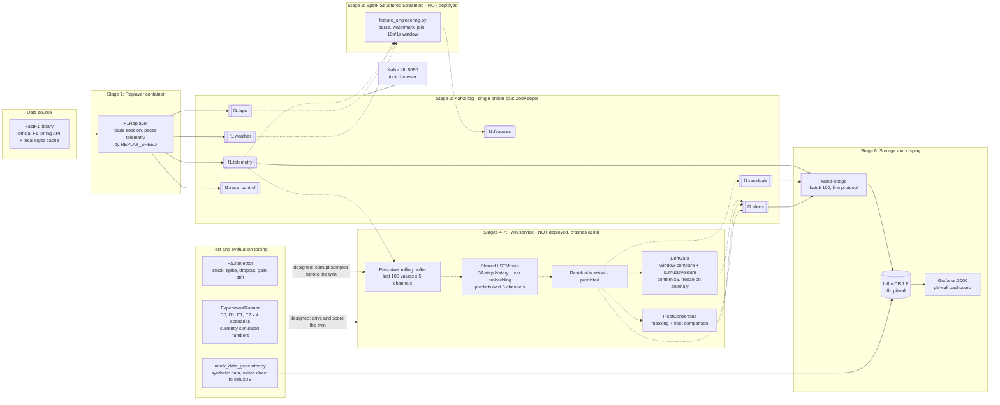
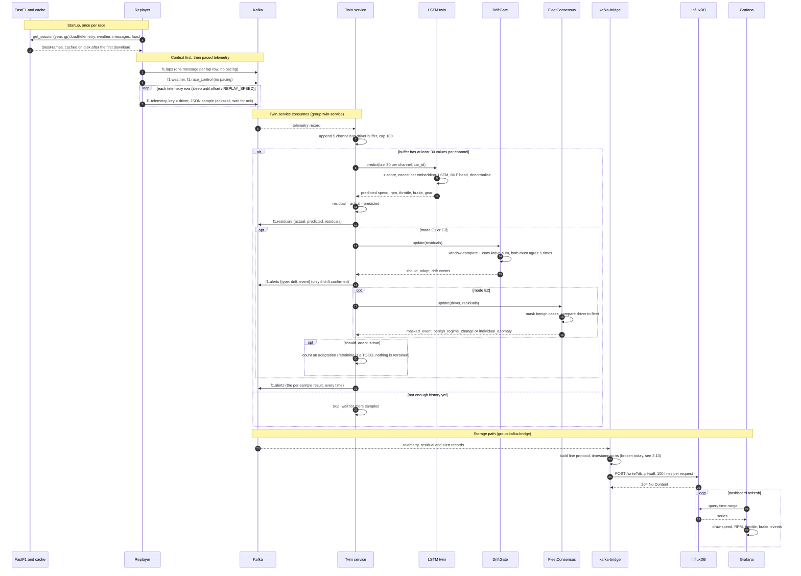

# PitWall Twin — The Whole Project, Explained End to End

> **How to read this document**
>
> - **Section 1** teaches the background ideas: what streaming data analytics is, the vocabulary, and a quick tour of the technologies this project leans on. Skip it if you already know streaming systems.
> - **Section 2** explains what the project does: first in plain language for a complete beginner (2A), then at an intermediate level (2B). It deliberately avoids file names and product names.
> - **Section 3** is the engineering view: every component, every message format, the maths, how each part is put together, and an honest list of what is complete, what is stubbed, and what is broken. Section 3 follows the same order as Section 2, so you can jump between them.
>
> All paths in Section 3 are relative to the project root `pitwall-twin-f1/`.
>
> **What this document is based on:** every source file, config file and script in the repository was read line by line. Statements about the code are taken from the code itself. Where the existing project docs (README, FINAL_REPORT, PROJECT_OVERVIEW, etc.) say something the code doesn't back up, this document points that out. A few claims about third-party library behaviour (mainly FastF1 attribute names) couldn't be run here and are marked *unverified*.

---

## Table of Contents

1. [Section 1 — Prerequisite Knowledge](#section-1--prerequisite-knowledge)
   - 1.1 Batch vs streaming
   - 1.2 Events, streams and time
   - 1.3 Message brokers and the log abstraction
   - 1.4 Stream processing operations
   - 1.5 Delivery guarantees, state and fault tolerance
   - 1.6 Time-series storage and dashboards
   - 1.7 Anomaly detection on streams
   - 1.8 Concept drift
   - 1.9 Digital twins
   - 1.10 Evaluating a detector
   - 1.11 A brief tour of the technologies
2. [Section 2 — What the Project Does](#section-2--what-the-project-does)
   - 2A Beginner view
   - 2B Intermediate view
3. [Section 3 — Technical Deep Dive](#section-3--technical-deep-dive)
   - 3.1 Repository map
   - 3.1.1 Complete architecture diagram
   - 3.1.2 Sequence diagram
   - 3.1.3 Component reference: input, processing, output
   - 3.2 Infrastructure (container stack)
   - 3.3 Stage 1: the race replayer
   - 3.4 Stage 2: the message broker and topics
   - 3.5 Stage 3: feature engineering (stream processor)
   - 3.6 Stage 4: the digital twin model
   - 3.7 Stage 5: the twin service
   - 3.8 Stage 6: drift gate
   - 3.9 Stage 7: fleet consensus
   - 3.10 Stage 8: storage bridge and dashboard
   - 3.11 Fault injection
   - 3.12 Experiment harness and results
   - 3.13 Configuration, scripts and tests
   - 3.14 Design intent vs implementation status
   - 3.15 Known defects (with fixes)
   - 3.16 Running it

---

# Section 1 — Prerequisite Knowledge

## 1.1 Batch vs streaming

There are two basic ways to process data.

**Batch processing** collects data first and processes it later, all in one go. Example: at the end of the day, add up every sale in a shop. Batch jobs see the *whole* dataset, so they can sort it, scan it more than once, and compute exact answers. The cost is **latency**: you only get the answer after the batch closes.

**Stream processing** handles each piece of data *as it arrives*, continuously, without ever seeing "the whole thing", because the data never ends. Example: flag a fraudulent card swipe within 200 ms of it happening. Streaming gives low latency, but you must answer with incomplete information and limited memory.

| Property | Batch | Streaming |
|---|---|---|
| Input | Bounded (has an end) | Unbounded (never ends) |
| Latency | Minutes to hours | Milliseconds to seconds |
| Memory model | Can hold/scan everything | Must summarise; keep bounded state |
| Correctness | Exact, repeatable | Often approximate; must handle late/out-of-order data |
| Typical tools | SQL warehouse, MapReduce, Spark batch | Kafka, Flink, Spark Structured Streaming, Kafka Streams |

**Streaming analytics** means computing useful results (aggregates, predictions, alerts) over streams in near real time. A Formula 1 pit wall is a textbook case: cars send hundreds of sensor readings per second, and engineers need to know *now* if something is going wrong, not after the race.

## 1.2 Events, streams and time

- **Event**: one immutable fact that happened at a moment. For example: "Car 44, at 14:03:12.350, speed = 287 km/h, RPM = 11,200."
- **Stream**: an unbounded, ordered-ish sequence of events.
- **Record / message**: an event encoded for transport, usually as a **key** (who it's about, e.g. driver 44) and a **value** (the payload, often JSON).
- **Schema**: the agreed structure of the value (field names and types). Producers and consumers must agree on it, or consumers misread data.

### The two clocks

Every streaming system has to deal with two different kinds of time:

- **Event time**: when the thing *actually happened* (stamped by the sensor).
- **Processing time**: when your system *gets around to* handling it.

They differ because networks delay, buffers fill, and machines restart. If you group events by processing time, a 2-second network hiccup can move readings into the wrong minute. Correct analytics groups by **event time**.

### Out-of-order and late data

Because of those delays, events arrive **out of order**. A reading stamped 12:00:05 may show up after one stamped 12:00:07. A **late event** arrives after you have already published a result for its time period.

### Watermarks

A **watermark** is the system's running estimate of "I believe I have now seen every event older than time *T*." It is usually computed as *maximum event time seen − allowed lateness*. For example, if the newest event seen is 12:00:30 and the allowed lateness is 10 s, the watermark is 12:00:20. Any window ending before 12:00:20 can be finalised and its memory freed. Events older than the watermark are dropped or handled specially.

Watermarks are the trade-off dial between **completeness** (wait longer, catch more late data) and **latency and memory** (wait less, answer faster, store less).

## 1.3 Message brokers and the log abstraction

A **message broker** sits between the systems that *produce* data and the systems that *consume* it, so neither needs to know about the other. Modern streaming brokers (Kafka being the best known) are built on one simple idea: the **append-only log**.

```
Partition 0:  [0][1][2][3][4][5][6] ...  ← new records appended at the end
                         ↑         ↑
                  consumer A    consumer B
                  (offset 3)    (offset 6)
```

Key terms:

- **Topic**: a named stream, e.g. `telemetry` or `weather`.
- **Partition**: a topic is split into partitions so it can be spread across machines and read in parallel. Order is guaranteed **only within a partition**, never across partitions.
- **Offset**: a record's position number within a partition. Consumers track "I've read up to offset N".
- **Key-based partitioning**: the producer hashes the record key to choose the partition. All records with the same key (e.g. the same driver) go to the same partition, so **per-key order is preserved**. This is why telemetry is keyed by driver.
- **Producer**: writes records. It can wait for acknowledgement (`acks=all` means "wait until every in-sync replica has stored it").
- **Consumer group**: a set of consumers sharing the work. Each partition is read by exactly one member of the group. More partitions means more possible parallelism.
- **Retention**: records stay for a configured time or size whether or not anyone has read them. Consumers can **replay** from an old offset. This is very different from a traditional queue, which deletes a message once it has been read.
- **Broker / cluster / coordinator**: a broker is one server. Older Kafka versions need **ZooKeeper** to coordinate cluster metadata; newer versions use the built-in KRaft mode.
- **Listeners / advertised listeners**: the network addresses a broker tells clients to connect to. A common trap is that a client inside Docker and a client on the host machine need *different* addresses.

Why use a broker at all? It **decouples** producers from consumers (either side can restart or scale on its own), **buffers** bursts, and lets **many consumers** read the same stream for different purposes: one stores it, one runs a model, one feeds a dashboard.

## 1.4 Stream processing operations

These are the building blocks a stream processor gives you.

**Stateless operations** look at one event at a time:
- *map / select*: transform fields (parse JSON, convert units).
- *filter*: drop events (e.g. readings with null speed).

**Stateful operations** remember something across events:

- **Windowing** splits the infinite stream into finite chunks so you can aggregate:
  - *Tumbling window*: fixed size, no overlap. `[0–10s) [10–20s) [20–30s)`
  - *Sliding (hopping) window*: fixed size, moving by a smaller step, so windows overlap. A 10 s window every 1 s gives `[0–10) [1–11) [2–12) …`. Each event lands in about 10 windows. The output is smooth, at about 10× the compute cost.
  - *Session window*: closes after a gap of inactivity.
- **Aggregation** inside windows: count, mean, standard deviation, max, first.
- **Joins**:
  - *Stream–static join*: enrich events with a fixed lookup table.
  - *Stream–stream join*: match events from two streams (e.g. telemetry with the current lap). Both sides must buffer events while waiting for a match, so you **must bound the state** with watermarks and a time-range condition. Otherwise memory grows forever.
- **Rolling / per-key state**: for example, "keep the last 30 readings for each driver". This is how a model that needs history gets fed in streaming mode.

**Output modes** say what a streaming query emits:
- *Append*: only new, final rows (needs watermarks for aggregations).
- *Update*: rows that changed since the last trigger.
- *Complete*: the whole result table each time (only works for small results).

**Micro-batch vs continuous**: some engines (e.g. Spark Structured Streaming) run the stream as a series of tiny batches every few hundred milliseconds. Others (e.g. Flink) process events one at a time. Micro-batching trades a little latency for simplicity and throughput.

## 1.5 Delivery guarantees, state and fault tolerance

Machines crash. When they come back, what happens to events in flight?

- **At-most-once**: may lose events, never duplicates them.
- **At-least-once**: never loses events, may duplicate them (the event is retried after a crash). This is the most common choice.
- **Exactly-once**: the effect on the output happens once. This needs replayable sources, **checkpointed state**, and idempotent or transactional sinks.

**Checkpointing** periodically saves (a) which offsets have been processed and (b) the operator state (window contents, join buffers) to durable storage. After a crash, the job reloads the checkpoint and resumes from those offsets.

**Backpressure**: when consumers are slower than producers, something has to give. Brokers absorb this by letting **consumer lag** (how far behind the consumer is) grow. Monitoring lag is the number-one operational metric of a streaming system.

**Idempotence**: an operation is idempotent if doing it twice has the same effect as doing it once. Writing a point with the same timestamp and tags to a time-series database is idempotent, which makes at-least-once delivery safe.

## 1.6 Time-series storage and dashboards

Streaming results usually end up in a **time-series database (TSDB)**, which is optimised for "append a value at time *t*, then query ranges and aggregates over time".

Typical TSDB data model (InfluxDB style):
- **Measurement**: like a table name, e.g. `f1_telemetry`.
- **Tags**: indexed string labels you filter or group by, e.g. `driver=44`.
- **Fields**: the actual numeric values, e.g. `speed=287.0`. Fields are not indexed.
- **Timestamp**: usually in nanoseconds.

InfluxDB's text write format, **line protocol**, looks like this:
```
f1_telemetry,driver=44 speed=287.0,rpm=11200 1696680192350000000
└measurement┘└─tags──┘ └──────fields───────┘ └──timestamp (ns)──┘
```

**Dashboards** (e.g. Grafana) query the TSDB on a refresh timer and draw time-series panels, heatmaps and tables. Dashboard config is often stored as JSON and **provisioned**: loaded automatically at start-up from files, rather than clicked together by hand.

## 1.7 Anomaly detection on streams

An **anomaly** is data that doesn't fit expected behaviour. In telemetry, anomalies come in a few flavours:

- **Point anomaly**: one bad reading (a spike).
- **Contextual anomaly**: a value that is normal in general but wrong *here* (full throttle in a hairpin).
- **Collective anomaly**: a sequence that is wrong as a whole (a sensor stuck at the same value for 5 s).

Common approaches:

1. **Static thresholds**: "alert if RPM > 13,000". Simple, but blind to context.
2. **Statistical baselines**: z-score against a rolling mean and standard deviation.
3. **Prediction-based (forecast residuals)**: train a model to predict the *next* value from recent history. The **residual** (actual − predicted) is small when behaviour is normal and large when something unexpected happens. You then threshold the residual, not the raw signal. This is the approach used here, and it comes from **Hundman et al., KDD 2018** ("Detecting Spacecraft Anomalies Using LSTMs and Nonparametric Dynamic Thresholding", NASA's *telemanom*). Their full method also smooths the errors and picks thresholds dynamically. Keep that in mind for Section 3.
4. **Reconstruction-based**: autoencoders, where you measure how badly the model rebuilds the input.

Why prediction-based fits telemetry: F1 signals are highly dynamic. 300 km/h is normal on a straight and absurd in a hairpin. A model that has learned the *dynamics* (speed follows throttle, RPM follows gear) knows what is normal *in context*.

### Neural networks for sequences: LSTM in brief

A **Recurrent Neural Network (RNN)** reads a sequence one step at a time and carries a hidden state, a running memory. Plain RNNs forget quickly (the vanishing-gradient problem). An **LSTM (Long Short-Term Memory)** adds a **cell state** and three **gates**:

- *forget gate*: what to erase from memory,
- *input gate*: what new information to write,
- *output gate*: what to expose as the hidden state.

This lets LSTMs keep information over longer spans. For forecasting, you feed the last *N* time steps and read the final hidden state, then pass it through a small fully connected network to output the next value or values.

Other pieces you'll meet:
- **Normalisation (z-score)**: `(x − mean) / std`, so speed (≈300) and throttle (≈0–100) are on similar scales.
- **Embedding**: a learned vector per category, e.g. per car. The model learns a small "personality" vector for each car, so one model can serve all cars.
- **Loss function (MSE)**: the mean squared error between prediction and truth.
- **Optimiser (Adam)**: adjusts the weights to reduce the loss.
- **Epoch**: one full pass through the training data.
- **Dropout**: randomly zeroes units during training to reduce overfitting.

## 1.8 Concept drift

A model trained on yesterday's data assumes tomorrow looks the same. When the data-generating process changes, the model's assumptions break. This is **concept drift** (or data drift).

Types:
- **Sudden**: rain starts and grip collapses.
- **Gradual / incremental**: the track "rubbers in" over a race, so lap times creep down. Tyres wear.
- **Recurring**: safety-car periods come and go.

In a residual-based detector, drift looks like **residuals creeping up for reasons that are not faults**. That causes false alarms. The obvious fix is to *retrain*, but there's a trap:

> **The adaptation dilemma**: if you retrain on everything continuously, the model will also happily learn a *developing fault* (a slowly failing sensor) as "the new normal", and stop alerting on it. If you never retrain, benign drift floods you with false alarms.

So you need to decide **when** to retrain, and **when not** to. That is the core idea of this project.

### Drift detectors

**ADWIN (ADaptive WINdowing)**, Bifet & Gavaldà 2007: keeps a variable-length window of recent values. It repeatedly checks whether any split of the window into "older" and "newer" parts has means that differ by more than a statistically justified bound (based on the Hoeffding inequality). If so, it drops the older part and reports drift. The window grows while things are stable and shrinks after a change.

**Page–Hinkley (PH) test**: a sequential test for a change in the mean. It accumulates `m_t = Σ (x_i − x̄_t − δ)` (with δ a small tolerance), tracks the minimum `M_t = min m_t`, and signals drift when `m_t − M_t > λ`. It reacts quickly to *sustained* shifts and ignores brief noise.

**DDM (Drift Detection Method)**: watches a classifier's error rate and warns or alarms when it rises beyond its historic minimum plus a few standard deviations.

The **River** library (online machine learning in Python) ships proper implementations of ADWIN, Page–Hinkley and DDM.

## 1.9 Digital twins

A **digital twin** is a software model that mirrors a physical system in real time, fed by that system's live sensor data. The twin's job is to say "given what I've just seen, here is what should happen next." When reality and the twin disagree, something is unusual. That is either a fault in the system or a change in its environment.

In this project, the "twin" is the LSTM forecaster: one model that mirrors the expected telemetry of every car.

## 1.10 Evaluating a detector

Count outcomes against known ground truth:

|  | Actually anomalous | Actually normal |
|---|---|---|
| **Alarm raised** | True Positive (TP) | False Positive (FP) |
| **No alarm** | False Negative (FN) | True Negative (TN) |

- **Precision** = TP / (TP + FP): when it alarms, how often is it right?
- **Recall** = TP / (TP + FN): of the real anomalies, how many did it catch?
- **F1** = harmonic mean of precision and recall.
- **F-β** = `(1+β²)·P·R / (β²·P + R)`. With **β = 0.5**, precision is weighted more heavily. That suits a pit wall, where false alarms erode trust quickly.
- **Detection delay**: time from anomaly start to alarm.
- **False alarms per hour**: an operator-facing metric.
- **Streaming system metrics**: throughput (messages/s), end-to-end latency percentiles (p50, p95), memory.

Ground truth is rare in real telemetry, so projects use **fault injection**: corrupt clean data in known ways at known times, then check whether the detector finds them.

## 1.11 A brief tour of the technologies

You only need a working mental model of each of these to follow Section 3.

| Technology | What it is | Role here |
|---|---|---|
| **Docker / Docker Compose** | Containers package an app with its dependencies. Compose starts several containers from one YAML file on a shared virtual network where they reach each other by service name. | Runs the whole stack locally. |
| **Apache Kafka** (+ ZooKeeper) | Distributed append-only log broker (see 1.3). | Central data bus for all streams. |
| **Kafka UI** | Web UI for browsing topics and messages. | Debugging and inspection. |
| **FastF1** | Python library that downloads and caches official F1 timing and telemetry data into pandas DataFrames. | Source of real race data. |
| **kafka-python** | Python Kafka client (`KafkaProducer`, `KafkaConsumer`). | Used by every Python service. |
| **Apache Spark Structured Streaming** | Micro-batch stream processor with a DataFrame/SQL API, watermarks, windows, joins and checkpoints. | Designed for feature engineering. |
| **PyTorch** | Deep learning framework. | Implements the LSTM twin. |
| **River** | Online ML library with drift detectors. | Named in the design. The code actually uses hand-written approximations instead. |
| **InfluxDB 1.8** | Time-series database. Query languages: InfluxQL (SQL-like, native in 1.x); Flux (native in 2.x). | Stores telemetry, residuals and alerts for dashboards. |
| **Grafana** | Dashboard and visualisation server. | The "pit wall" screen. |
| **pydantic-settings** | Loads typed config from environment variables or a `.env` file. | Replayer configuration. |

**Python and pandas basics you'll see**: DataFrame filtering (`df[df['Driver'] == d]`), `iterrows()`, `Timedelta` (a duration such as "1 h 02 m 03 s into the session"), and dataclasses.

---

# Section 2 — What the Project Does

## 2A. Beginner view

### The story

Picture the **pit wall** at a Formula 1 race: a row of engineers staring at screens full of squiggly lines. Each of the 20 cars is constantly sending back numbers: how fast it's going, engine revs, how hard the driver is pressing the accelerator and brake, which gear it's in. The engineers' job is to spot trouble early: a sensor that's lying, an engine starting to fail.

Twenty cars × several signals × many readings per second is far too much for humans to watch. This project builds an **automatic assistant** for that pit wall.

### The big idea in one paragraph

The assistant has a **"twin"**: an imaginary copy of the car that has learned how a healthy car behaves. Every moment, the twin looks at the last few seconds of real data and **guesses what the car will do next**. Then it compares its guess with what the car actually did. If the guess is close, everything is normal. If the guess is way off, the twin is **surprised**, and surprise is a hint that something might be wrong.

### The catch, and the clever part

Not every surprise means something is broken.

- **The world changes.** It starts raining. The track gets grippier as rubber builds up. Tyres wear out. These make *every* car behave a bit differently, and the twin will be surprised even though nothing is broken.
- **One option** is to keep re-teaching the twin all the time so it gets used to changes. But then, if a sensor is *slowly* breaking, the twin would get used to that too, and stop warning anyone. That's dangerous.

So the project adds two smart helpers:

1. **The drift gate**: a referee that watches the twin's surprise level over time. It decides: "Has the world genuinely shifted, so we should re-teach the twin?" And it adds: "But NOT while an alarm is active, in case we'd be teaching it to accept a fault."
2. **Fleet consensus**: a team-wide check. If **all** the cars suddenly surprise the twin at once (say a safety car comes out and everyone slows down), it's the *world* that changed, not one car. If **only one** car is surprising the twin, that car probably has a real problem. It also ignores moments that are expected to be weird for one car, like driving into the pits or being stuck behind another car.

### What happens, step by step

```
  Past race data        "Pretend it's live"       Shared message
  (real F1 races)  ───▶  race replayer      ───▶  highway (named lanes:
                                                   telemetry, laps, weather,
                                                   race messages)
                                                          │
                       ┌──────────────────────────────────┤
                       ▼                                  ▼
             Summariser (averages,            Twin: predicts next moment,
             wobble, current lap,             measures surprise per car
             tyres, weather)                              │
                                                          ▼
                                          Drift gate + fleet consensus:
                                          "world changed?" vs "this car is odd?"
                                                          │
                                                          ▼
                                              Storage of everything over time
                                                          │
                                                          ▼
                                             Pit-wall screen (live charts)
```

1. **Replay a real race as if it were live.** Real recorded F1 races are played back reading by reading, with the original timing (optionally sped up).
2. **Send everything onto a shared "message highway"** with separate lanes for car sensor readings, lap information, weather and race-control messages.
3. **Summarise** the raw readings into short-term averages, joined with context such as which lap it is and which tyres the car is on.
4. **The twin predicts and measures surprise** for every car, continuously.
5. **The referee and the team check** decide whether a surprise is a fault, a world change, or something to ignore.
6. **Save everything** in a database built for time-stamped data.
7. **Show it on a dashboard**: speed traces, revs, throttle, brake, surprise levels and alerts.
8. **Test it by breaking things on purpose.** To check the assistant works, the project can inject fake faults (a stuck sensor, a sudden spike, missing readings, a slow creep) and see whether they get caught.

### What the project delivers

- A **ready-to-launch environment** that starts all the services with one command.
- A **race replayer** that turns historical races into a live-looking stream.
- A **summariser** that computes rolling features with race context.
- The **twin**, one shared model for all 20 cars.
- The **drift gate** and **fleet consensus** helpers.
- A **fault injector** for controlled testing.
- An **experiment harness** that compares four strategies across four race situations.
- A **dashboard** for the pit wall.
- **Documentation and a written report.**

## 2B. Intermediate view

### Architecture as a pipeline of stages

The system is a classic **streaming pipeline**: independent stages connected through a durable, partitioned message log. Each stage reads one or more named streams and writes new ones. Because stages only talk through the log, each can be restarted, scaled or replaced on its own, and several consumers can read the same stream for different purposes.

```
                   ┌──────────────────────── message log ────────────────────────┐
 Historical  ─▶ Replayer ─▶ [telemetry]* [laps] [weather] [race-control]          │
 race store                     │  │        │       │                             │
                                │  └────────┴───────┴─▶ Feature engineering ─▶ [features]
                                │                                                 │
                                ├─▶ Twin service ─▶ [residuals]  [alerts]         │
                                │   (predict, residual, drift gate, consensus)    │
                                │                    │          │                 │
                                └────────────────────┴──────────┴─▶ Storage bridge ─▶ Time-series DB ─▶ Dashboard
                                                                                  │
 * telemetry is partitioned by driver, so each car's readings stay in order       │
                   └──────────────────────────────────────────────────────────────┘
```

**Streams in the system**

| Stream | Produced by | Contents | Keyed by |
|---|---|---|---|
| telemetry | Replayer | Per-sample speed, RPM, throttle, brake, gear, DRS, x/y/z position, session time | Driver |
| laps | Replayer | Lap number, tyre compound and age, pit in/out, lap time | Driver |
| weather | Replayer | Air/track temperature, humidity, pressure, wind, rainfall | — |
| race-control | Replayer | Flags and official messages | — |
| features | Feature engineering | 10-second rolling statistics per driver plus context | — |
| residuals | Twin service | Actual vs predicted vs residual, per driver per sample | — |
| alerts | Twin service | Drift events and per-sample results | — |

### Stage-by-stage behaviour

**1. Replay.** A historical session is loaded with all its tables (car telemetry, laps, weather, race-control messages). The context tables (laps, weather, messages) are published first. Then telemetry is published with sleeps between records, so the stream follows the original timeline divided by a **speed factor** (1×, 10×, 50×). Telemetry is keyed by driver so per-car order is preserved.

**2. Transport.** The log keeps every stream durable and replayable. A separate web UI lets you browse streams and messages.

**3. Feature engineering.** A stream processor parses each stream against a declared schema and:
- applies **event-time watermarks** so late data is bounded,
- **joins** telemetry with the driver's current lap context (lap number, tyre) and with the most recent weather,
- computes **sliding-window aggregates**: a 10-second window that advances every 1 second, per driver. The aggregates are mean and standard deviation of speed and RPM, mean throttle, mean brake, mean track temperature, current lap, tyre compound, tyre age and rainfall,
- publishes the result as a new features stream.

**4. Twin prediction.** The twin service keeps a **rolling buffer of the last readings per driver**. Once a driver has at least 30 readings in each of 5 channels (speed, RPM, throttle, brake, gear), it asks the twin model to predict the next value of all 5 channels at once. The model is a single network shared by all cars, with a learned **per-car identity vector**, so it can capture car-specific behaviour without training 100 separate models (5 channels × 20 cars). It then computes **residuals** (actual − predicted) and publishes them.

**5. Drift gate.** For each channel, the gate tracks the size of the residuals over time and runs **two detectors**:
- a **window comparison** detector ("is the recent average surprise meaningfully different from the early baseline?"), and
- a **cumulative-sum** detector ("has surprise been consistently above baseline for a while?").

Drift is **confirmed only when both agree, several times in a row**. Requiring agreement and persistence suppresses false triggers. When drift is confirmed, the gate recommends **adaptation (retraining)**, *unless* recent residuals are very large, which suggests an active anomaly. In that case adaptation is **frozen** so the model doesn't learn the fault.

**6. Fleet consensus.** For each car, it compares that car's recent surprise to the fleet average:
- If the car is in a **masked state** (pit in/out lap, being lapped, within 1 s of the car ahead, tyre change), the sample is ignored.
- If **more than 70% of the fleet** shows elevated surprise at the same time, it's a **benign regime change** (safety car, rain, track evolution). Don't alarm and don't retrain on it.
- Otherwise, elevated surprise on a single car is an **individual anomaly**.

**7. Storage and display.** A bridge consumes telemetry, residuals and alerts, batches them in groups of 100, and writes them to the time-series database. Telemetry is tagged by driver. The dashboard plots speed, RPM, throttle and brake traces for all drivers, plus anomaly event panels.

### The four strategies being compared

The research question is: **does gated, fleet-aware adaptation beat simpler strategies?**

| Strategy | Retraining policy | Expected weakness / strength |
|---|---|---|
| **B0**: static baseline | Train once, never retrain | Drifts away from reality, so false alarms build up over a race |
| **B1**: continuous adaptation | Retrain on all new data | Tracks drift, but also learns developing faults, so it misses slow failures |
| **E1**: drift-gated | Retrain only on confirmed drift, never during an active anomaly | Adapts to real change while protecting against learning faults |
| **E2**: drift-gated + fleet consensus | E1, plus classify each shift as fleet-wide (benign) vs single-car (anomaly), plus masking | Should be most robust to safety cars, rain and traffic |

### The four test scenarios

| Scenario | What it stresses |
|---|---|
| Dry race | Normal baseline conditions |
| Wet race | Sudden, fleet-wide change in grip, plus tyre changes |
| Safety cars | Every car slows at the same time, so individual residuals spike |
| Injected faults | Known synthetic faults with exact ground truth (stuck, spike, dropout, gradual gain drift) |

### Metrics reported

Precision, recall, F1, **F0.5** (precision-weighted, because false alarms are costly on a pit wall), detection delay, false alarms per hour, drift recovery time, adaptation cost, and streaming performance (throughput, p50/p95 latency, peak memory).

### How complete is this? (important)

The **design** above is complete and coherent. The **implementation** is at different stages per part. The replay, transport, storage and dashboard infrastructure exists. The twin model, drift gate, consensus and fault injector exist as working building blocks. But the end-to-end path that connects them isn't finished, and **the experiment results tables were produced by a placeholder that generates numbers rather than by running the pipeline.** Section 3.14 gives the exact status of each part.

---

# Section 3 — Technical Deep Dive

## 3.1 Repository map

```
pitwall-twin-f1/
├── docker-compose.yml              # Container stack (3.2)
├── docker/
│   ├── replayer/{Dockerfile,requirements.txt}
│   └── kafka-bridge/{Dockerfile,requirements.txt}
├── replayer/                       # Stage 1 (3.3)
│   ├── config.py                   # pydantic-settings config
│   └── main.py                     # F1Replayer: FastF1 → Kafka
├── spark-jobs/
│   └── feature_engineering.py      # Stage 3 (3.5)
├── twin-model/
│   ├── lstm_twin.py                # Stage 4 model (3.6)
│   ├── twin_service.py             # Stage 5 service (3.7)
│   ├── drift_gate.py               # Stages 6 & 7 (3.8, 3.9)
│   └── fault_injection.py          # Fault injector (3.11)
├── kafka_to_influxdb_http.py       # Stage 8 bridge, the one actually run (3.10)
├── kafka_to_influxdb.py            # Alternate bridge using the influxdb client lib
├── mock_data_generator.py          # Writes synthetic data straight to InfluxDB
├── dashboards/                     # Grafana provisioning + dashboard JSON
├── experiments/runner.py           # Experiment harness (3.12)
├── results/{results.json,REPORT.md}# Harness output
├── tests/test_replayer.py          # Smoke tests
├── data/f1_cache/                  # FastF1 HTTP cache (sqlite)
├── start.sh, run.sh                # Startup scripts
├── .env.example, requirements-dev.txt
└── *.md                            # README, QUICKSTART, FINAL_REPORT, etc.
```

Note: `twin-model/` contains a hyphen, so it **cannot be imported as a Python package** (`import twin-model.lstm_twin` is a syntax error). `twin_service.py` uses flat imports (`from lstm_twin import ...`), so it must be run with `twin-model/` as the working directory or on `PYTHONPATH`.

## 3.1.1 Complete architecture diagram

The diagram shows the **designed** pipeline. Solid arrows are paths that exist in code and run in the shipped container stack. Dashed arrows are designed paths that are not running, or are broken, today (see 3.14). Renders as a diagram in GitHub, VS Code (Markdown Preview Mermaid support) and most Markdown viewers.



The same picture as plain text, for viewers without Mermaid:

```
                         ┌─────────────┐
                         │   FastF1    │  (downloads + caches a historical race)
                         └──────┬──────┘
                                ▼
                         ┌─────────────┐
                         │  Replayer   │  paces rows by REPLAY_SPEED
                         └──┬──┬──┬──┬─┘
        ┌────────────────────┘  │  │  └────────────────────┐
        ▼                       ▼  ▼                       ▼
  f1.telemetry             f1.laps f1.weather        f1.race_control
  (key = driver)               │       │               (no consumer)
     │  │  │                   │       │
     │  │  └───────────────────┴───────┴──────► Spark job ─ ─► f1.features
     │  │                                      (not deployed)   (no consumer)
     │  └────────────────────────────────────────────────────────────┐
     │                                                               ▼
     │                                              ┌───────────────────────────────┐
     │                                              │ Twin service (not deployed)   │
     │                                              │ buffer → LSTM → residual      │
     │                                              │   ├► DriftGate  (E1, E2)      │
     │                                              │   └► FleetConsensus (E2)      │
     │                                              └──────┬─────────────────┬──────┘
     │                                                     ▼                 ▼
     │                                              f1.residuals        f1.alerts
     │                                                     │                 │
     └──────────────────────────────┬──────────────────────┴─────────────────┘
                                    ▼
                             kafka-bridge (batches of 100)
                                    ▼
                              InfluxDB (pitwall)  ◄── mock_data_generator.py
                                    ▼
                               Grafana dashboard
```

## 3.1.2 Sequence diagram: one telemetry sample, end to end

This traces a single reading for one car from the archive to the dashboard, as the code is **designed** to behave. Messages marked *(broken today)* fail in the current code for the reasons in 3.15.



## 3.1.3 Component reference: input, processing, output

Each entry answers four questions: what goes **in**, what the component **does**, how the data is **changed**, and what comes **out**. Status flags match 3.14.

### Replayer (`replayer/main.py`) — runs on demand

| | |
|---|---|
| **Input** | Race identifier `(year, grand prix name)`; environment settings (`KAFKA_BOOTSTRAP_SERVERS`, `REPLAY_SPEED`, cache dir). Raw data comes from FastF1 as pandas DataFrames: telemetry, laps, weather, race-control messages. |
| **What it does** | Downloads and caches a historical session. Publishes laps, weather and messages immediately. Then walks telemetry rows and sleeps so that publish time follows the original timeline divided by `REPLAY_SPEED`. |
| **How data changes** | Each DataFrame row becomes a flat JSON object. Column names are lower-cased and renamed (`Speed` → `speed`, `Time` → `timestamp`). Numbers are cast to `float`/`int`. A session-relative offset is added as `session_time`. Telemetry gets a key (`driver`) so one car's rows stay ordered. |
| **Output** | Records on `f1.telemetry` (key = driver), `f1.laps`, `f1.weather`, `f1.race_control`. |
| **Example** | Row `Time=0 days 01:02:03.350, Speed=287, Brake=False` becomes `{"timestamp":"...","driver":"44","speed":287.0,"brake":null,...}`. The `brake: null` and the duration-style timestamp are the replayer bugs in 3.3. |

### Kafka (`confluentinc/cp-kafka`) — runs

| | |
|---|---|
| **Input** | JSON records from the replayer and the twin service (and, by design, the Spark job). |
| **What it does** | Appends each record to a topic partition on disk and keeps it for replay. Serves each consumer group independently from its own offset. |
| **How data changes** | Not changed. Only an offset and a broker timestamp are added. Topics are auto-created (1 partition each by default). |
| **Output** | The same records to every consumer group: `twin-service`, `kafka-bridge`, Spark. |

### Spark feature job (`spark-jobs/feature_engineering.py`) — NOT deployed

| | |
|---|---|
| **Input** | `f1.telemetry`, `f1.laps`, `f1.weather` (latest offsets only). |
| **What it does** | Parses JSON into typed columns, applies watermarks, attaches lap and weather context to each telemetry sample, then aggregates per driver. |
| **How data changes** | Raw samples (many per second) become one row per driver per 1-second step. Each row summarises the previous 10 seconds: `speed_mean`, `speed_std`, `rpm_mean`, `rpm_std`, `throttle_mean`, `brake_mean`, `track_temp_mean`, `current_lap`, `tyre_compound`, `tyre_age`, `rainfall`. Each sample contributes to about 10 overlapping windows. |
| **Output** | JSON rows on `f1.features`. Nothing in the repo reads that topic. |

### Per-driver buffer (inside `twin_service.py`) — NOT deployed

| | |
|---|---|
| **Input** | One decoded telemetry record at a time from `f1.telemetry`. |
| **What it does** | Keeps the most recent values per driver and channel, and decides when there is enough history to predict. |
| **How data changes** | Records are split into five per-channel lists (`speed, rpm, throttle, brake, gear`), each capped at 100. Null readings are skipped, which can desynchronise channels. |
| **Output** | A history dict `{channel: [last values]}` for the model, once every channel has at least 30 values. |

### LSTM twin (`twin-model/lstm_twin.py`) — building block; untrained in the service

| | |
|---|---|
| **Input** | History dict (30 most recent values for each of 5 channels) and a `car_id` from 0 to 19. |
| **What it does** | Predicts the next value of all five channels. |
| **How data changes** | (1) z-score each channel using stored mean and std. (2) Stack to shape `(1, 30, 5)`. (3) Look up the car's 16-number embedding and attach it to every time step, giving `(1, 30, 21)`. (4) Two LSTM layers of 128 units. (5) Take the last time step's 128-number state. (6) Three linear layers, 128 → 128 → 64 → 5. (7) Reverse the z-score to raw units. |
| **Output** | Predicted `{speed, rpm, throttle, brake, gear}`. |
| **Training side** | `fit()` slices a history into windows (30 inputs, 1 target), minimises mean squared error with Adam, and `save()` writes `shared_lstm_model.pt` and `scaler_stats.json`. The service never calls `fit()` or `load()`. |

### Residual computation (`TelemetryTwin.get_residuals`, called by the service)

| | |
|---|---|
| **Input** | Actual values from the current record and the twin's predictions. |
| **What it does** | Measures the twin's surprise per channel. |
| **How data changes** | `residual = actual − predicted`, in raw units (km/h, rpm, % and gear steps). `None` if either side is missing. |
| **Output** | `{channel: residual}`, published as `f1.residuals` together with `actual` and `predicted`, and passed on to the drift gate and fleet consensus. |

### DriftGate (`twin-model/drift_gate.py`) — modes E1/E2; fails with `NameError` today

| | |
|---|---|
| **Input** | A residual dict each time a prediction is made. Config: baseline size 100, recent size 50, 5% change threshold, Page–Hinkley limit 5, 5 confirmations. |
| **What it does** | Decides whether the *distribution* of a channel's errors has shifted, and whether retraining is safe. |
| **How data changes** | Takes absolute residuals and appends them to a growing per-channel history. After 100 samples: (a) compares the mean of the last 50 to the mean of the first 100 and raises flag A if the relative change exceeds 5%; (b) adds the normalised distance from the baseline mean to a running sum and raises flag B if the sum's magnitude exceeds 5. Both flags must be true for a confirmation. Five confirmations (a missed one subtracts 1) become a drift event and reset the running sum. Finally, if any channel's last 10 absolute residuals exceed 2.0, an anomaly is considered active and adaptation is blocked. |
| **Output** | `(should_adapt, [DriftEvent])`. Events carry channel, severity 0–1 and a description, and go to `f1.alerts`. |

### FleetConsensus (`twin-model/drift_gate.py`) — mode E2 only; breaks for car numbers above 19

| | |
|---|---|
| **Input** | One driver's residuals, optional lap context (pit in/out, lapped, tyre compound change) and optional gap to the car ahead. |
| **What it does** | Separates "this car is odd" from "everyone is odd", and ignores known-benign situations. |
| **How data changes** | Reduces residuals to one number (mean absolute residual). Stores `0` instead if the situation is masked (pit lap, lapped, within 1 s, tyre change). Keeps 100 recent values per driver. Computes a fleet mean over non-zero recent values and counts drivers whose recent mean exceeds 1.2× the fleet mean. Divides by 19 to get a consensus ratio. |
| **Output** | `{driver, driver_residual, fleet_mean_residual, consensus_ratio, is_masked, type}`, with `type` one of `masked_event`, `benign_regime_change` (ratio > 0.7) or `individual_anomaly`. Added to the in-memory result but not published separately today. |

### Twin service orchestration (`twin-model/twin_service.py`) — NOT deployed

| | |
|---|---|
| **Input** | `f1.telemetry` records; mode `B0`, `B1`, `E1` or `E2`. |
| **What it does** | Wires buffer, model, residuals, drift gate and consensus together per message, according to the mode. |
| **How data changes** | Telemetry record → history → prediction → residuals → drift events and classification. Mode `B0`/`B1`: stop after residuals. `E1`: add drift gate. `E2`: add fleet consensus. |
| **Output** | Records on `f1.residuals` and `f1.alerts`; counters for predictions and adaptations. No retraining happens. |

### kafka-bridge (`kafka_to_influxdb_http.py`) — runs, but drops real replayer data

| | |
|---|---|
| **Input** | `f1.telemetry`, `f1.residuals`, `f1.alerts`. |
| **What it does** | Moves selected fields into the time-series database in batches. |
| **How data changes** | JSON becomes line protocol text. `f1_telemetry` gets tag `driver` and six fields. `f1_residuals` keeps only speed and RPM residuals. `f1_alerts` gets tags `driver`, `type` and a `severity` field. The timestamp is converted to nanoseconds. 100 lines are joined with newlines per request. |
| **Output** | HTTP `POST /write?db=pitwall`. Success is status 204. |

### InfluxDB 1.8 — runs

| | |
|---|---|
| **Input** | Line-protocol batches from the bridge or `mock_data_generator.py`. |
| **What it does** | Stores points by time and tags and answers range queries. |
| **How data changes** | Parsed into measurements `f1_telemetry`, `f1_residuals`, `f1_alerts`, indexed by tag `driver`. |
| **Output** | Query results to Grafana (and `curl`). |

### Grafana — runs

| | |
|---|---|
| **Input** | Time-range queries against the `pitwall` database; provisioned datasource and dashboard JSON. |
| **What it does** | Periodically queries and renders panels: Speed, RPM, Throttle, Brake traces and an anomaly events panel. |
| **How data changes** | Series are drawn as lines or aggregated into a pie of event counts. |
| **Output** | The browser dashboard at port 3000. The datasource is set to Flux while the database speaks InfluxQL, so panels may show "No data". |

### FaultInjector (`twin-model/fault_injection.py`) — standalone

| | |
|---|---|
| **Input** | A telemetry dict and the current time. A schedule of faults (type, channel, start, end, severity). |
| **What it does** | Overwrites one channel's value during a fault window so that detectors can be tested against known ground truth. |
| **How data changes** | Spike: `v + severity·|v| + noise`. Dropout: `None`. Gain drift: `v · (1 + rate · elapsed)`. Stuck sensor: no change (not implemented). Only the first active fault applies per message. |
| **Output** | The modified telemetry dict and the id of the fault applied. `export_faults_json()` gives the schedule. |

### ExperimentRunner (`experiments/runner.py`) — runs, but results are simulated

| | |
|---|---|
| **Input** | Config names (B0, B1, E1, E2), scenario names and a duration. |
| **What it does** | Designed to drive the pipeline per config and scenario and score it. Today it computes numbers from a formula. |
| **How data changes** | Config and scenario offsets are added to a base precision and recall. F1 and F0.5 are derived from those. |
| **Output** | `results/results.json` (16 rows) and `results/REPORT.md`. |

### mock_data_generator.py — standalone demo helper

| | |
|---|---|
| **Input** | InfluxDB host from the environment. |
| **What it does** | Generates sine-wave-plus-noise telemetry, fake residuals and fake alerts for 20 drivers. |
| **Output** | Points written directly to InfluxDB. It bypasses Kafka, so a populated dashboard only proves Grafana and InfluxDB work, not the pipeline. |

### The data flow in one line per hop

`FastF1 DataFrame row` → **Replayer** → `JSON sample` → **Kafka** → **buffer** → `30 × 5 history` → **LSTM** → `5 predictions` → **residual** → `5 errors` → **DriftGate / FleetConsensus** → `events, class labels` → **Kafka** → **bridge** → `line protocol` → **InfluxDB** → **Grafana**.

## 3.2 Infrastructure (container stack)

Defined in `docker-compose.yml`. All services share the bridge network `pitwall`.

| Service | Image | Ports | Notes |
|---|---|---|---|
| `zookeeper` | `confluentinc/cp-zookeeper:7.5.0` | 2181 | Kafka metadata coordination |
| `kafka` | `confluentinc/cp-kafka:7.5.0` | 9092, 9101 | Single broker, `KAFKA_AUTO_CREATE_TOPICS_ENABLE=true`, offsets replication factor 1 |
| `kafka-ui` | `provectuslabs/kafka-ui:latest` | 8080 | Points at `kafka:29092` |
| `influxdb` | `influxdb:1.8` | 8086 | DB `pitwall`, HTTP auth **disabled** |
| `grafana` | `grafana/grafana:9.5.3` | 3000 | admin/admin, provisioning volumes mounted |
| `kafka-bridge` | built from `docker/kafka-bridge/` | — | Runs `kafka_to_influxdb_http.py` (mounted as a volume, overriding the image CMD) |
| `replayer` | built from `docker/replayer/` | — | Idles with `tail -f /dev/null`; you run it on demand |

**Not running:** Spark master/worker are commented out ("image availability"). No container runs `twin_service.py`. So in the stack as shipped, **stages 3–7 don't run**.

**Kafka listeners**, the dual-listener pattern:
```
KAFKA_ADVERTISED_LISTENERS: PLAINTEXT://kafka:29092,PLAINTEXT_HOST://kafka:9092
KAFKA_INTER_BROKER_LISTENER_NAME: PLAINTEXT
```
Containers use `kafka:29092`. The "host" listener is advertised as `kafka:9092` rather than `localhost:9092`. A client on the host machine connects to `localhost:9092`, receives metadata saying "talk to `kafka:9092`", and fails unless `kafka` resolves on the host (e.g. through `/etc/hosts`). The usual fix is `PLAINTEXT_HOST://localhost:9092`.

**Partitions:** the README talks about "20 partitions", but nothing creates topics with 20 partitions. Auto-created topics get the broker default (`num.partitions=1`). See the replayer issue in 3.3.

**Grafana provisioning:**
- Datasource (`dashboards/datasources.yml`): InfluxDB at `http://influxdb:8086`, DB `pitwall`, **but** `jsonData.version: Flux`. Flux is the InfluxDB 2.x language. With a 1.8 server and InfluxQL queries this mismatch is a likely cause of the "No data" problem noted in `SYSTEM_STATUS.md`. Removing `version: Flux` (so InfluxQL is used) is the fix.
- Dashboard: compose mounts `f1_telemetry_dashboard.json` (v1). A v2 JSON and a `pitwall_dashboard.json` also exist. The v2 panels are Speed / RPM / Throttle / Brake time series and an "Anomaly Detection Events" pie chart. Their `query` strings are empty (the queries live in other target fields or were never filled in).
- `GF_INSTALL_PLUGINS: grafana-piechart-panel` installs a deprecated plugin. Grafana 9 has a built-in pie chart.

## 3.3 Stage 1: the race replayer

**Files:** `replayer/config.py`, `replayer/main.py`. **Section 2 counterpart:** "Replay".

### Configuration
`Settings(BaseSettings)` reads environment variables (case-insensitive) or `.env`:

| Setting | Default | Meaning |
|---|---|---|
| `kafka_bootstrap_servers` | `localhost:9092` | Overridden to `kafka:29092` in compose |
| `f1_cache_dir` | `/data/f1_cache` | FastF1 cache, mounted from `./data` |
| `replay_speed` | `1.0` | Time compression factor |
| `start_year`, `start_round` | 2018, 1 | Declared but **unused** |
| topic names | `f1.telemetry`, `f1.laps`, `f1.race_control`, `f1.weather` | |

`fastf1.Cache.enable_cache(...)` runs at import time.

### Producer
```python
KafkaProducer(bootstrap_servers=..., value_serializer=json→utf8, acks='all', retries=3)
```
`default=str` in `json.dumps` turns non-JSON types (Timedelta, Timestamp) into strings.

### `load_session(year, gp)`
`fastf1.get_session(year, gp)` → `session.load(telemetry=True, weather=True, messages=True, laps=True)`. On failure it retries a plain `load()`. Returns a bool.

### `run(year, gp)` order
`stream_laps()` → `stream_weather()` → `stream_race_control()` → `stream_telemetry()` → `flush()`. Context goes out first, all at once with **no pacing**. Then telemetry is paced.

### `stream_telemetry()`, the pacing logic
```python
base_time = session.telemetry['Time'].min()
replay_start = time.time()
for driver in session.drivers:
    for row in driver's telemetry:
        offset = (row.Time - base_time).total_seconds()
        sleep(max(0, offset/replay_speed - (now - replay_start)))
        send(f1.telemetry, msg, partition=int(driver) % 20, key=driver)
        future.get(timeout=5)       # synchronous ack per message
```
The idea is to sleep until wall-clock time catches up with scaled event time.

**Telemetry message schema** (JSON):
```json
{ "timestamp": "...", "driver": "44", "speed": 287.0, "rpm": 11200.0,
  "throttle": 100.0, "brake": 0.0, "gear": 7, "drs": 12,
  "x": 1234.0, "y": -567.0, "z": 12.0, "session_time": 3723.35 }
```
Laps, weather and race-control messages have similar flat schemas (see the code for the field lists).

### Low-level issues in the replayer

1. **Drivers are streamed one after another, not interleaved.** The outer loop is per driver. Driver 1's whole race is paced in real time (about 2 h at 1×). By then the wall clock has passed every offset, so drivers 2–20 are sent **with no delay at all**. Downstream never sees 20 cars at the same moment, which defeats fleet consensus. Fix: merge all drivers' rows, sort by `Time`, and stream in one loop.
2. **An explicit partition that doesn't exist.** `partition=int(driver) % 20` needs 20 partitions. The auto-created topic has 1, so sends to partitions ≥1 fail. Fix: create the topic with 20 partitions up front (e.g. `kafka-topics --create --partitions 20` or `KAFKA_NUM_PARTITIONS=20`), or drop `partition=` and let key hashing choose.
3. **Falsy zeros become `null`.** `float(row['Speed']) if row['Speed'] else None` turns `0` into `None`. Brake = 0 and throttle = 0 are extremely common, so most brake values become null. Fix: `None if pd.isna(v) else float(v)`.
4. **`timestamp` is not a wall-clock time.** In FastF1, `Time` is a session-relative `Timedelta`. `.isoformat()` produces an ISO-8601 *duration* such as `P0DT1H02M03.35S`. Downstream consumers expect an epoch number (the bridge) or a timestamp (Spark), and neither can parse this. Fix: send `session.t0_date + Time` as an ISO datetime, or epoch ns.
5. **Synchronous send.** `future.get(timeout=5)` on every record turns async batching into one network round trip per record, which caps throughput.
6. **The log throttle is effectively random.** `time.time() % 100 < 0.1` doesn't mean "every 100 messages".
7. *Unverified:* FastF1 3.x documents per-driver `session.car_data` / `session.pos_data` and `session.weather_data` / `session.race_control_messages`. The code reads `session.telemetry`, `session.weather` and `session.messages`. If those attributes don't exist, telemetry streaming raises and weather/messages are silently skipped through the `hasattr` checks. Check against the installed FastF1 version (the image pins `fastf1>=3.6.0`; the docs mention 3.8.3).

## 3.4 Stage 2: the message broker and topics

**Section 2 counterpart:** "Transport".

| Topic | Producer | Consumers (in code) |
|---|---|---|
| `f1.telemetry` | replayer | Spark job, twin service, bridge |
| `f1.laps` | replayer | Spark job |
| `f1.weather` | replayer | Spark job |
| `f1.race_control` | replayer | *(none)* |
| `f1.features` | Spark job | *(none, nothing reads features)* |
| `f1.residuals` | twin service | bridge |
| `f1.alerts` | twin service | bridge |

Consumer groups: `twin-service` and `kafka-bridge` (plus `kafka-to-influxdb` for the alternate bridge). Because they are separate groups, **each one receives the full stream independently**. That is the fan-out property from 1.3. Both use `auto_offset_reset='earliest'`, so a new group replays the topic from the beginning.

## 3.5 Stage 3: feature engineering (stream processor)

**File:** `spark-jobs/feature_engineering.py`. **Section 2 counterpart:** "Feature engineering". **Status:** not deployed (Spark is commented out of compose).

### Pipeline
1. `SparkSession` with `spark.sql.shuffle.partitions=20`, so aggregation output has 20 partitions, matching about 20 drivers.
2. **Sources:** three `readStream.format("kafka")` sources (`f1.telemetry`, `f1.laps`, `f1.weather`), `startingOffsets=latest`. The value is cast to string and parsed with `from_json(..., schema)` against explicit `StructType`s.
3. **Watermarks:** telemetry `event_time` 10 s; weather 30 s; **laps: none**.
4. **Join 1 (stream–stream left outer):** telemetry ⟕ laps on `driver == driver AND telemetry.timestamp >= lap_timestamp`.
5. **Join 2 (stream–stream left outer):** result ⟕ weather on `timestamp >= weather_timestamp` (no key).
6. **Aggregation:** `groupBy(window(timestamp, "10 seconds", "1 second"), driver)` with `avg/stddev(speed)`, `avg/stddev(rpm)`, `avg(throttle)`, `avg(brake)`, `avg(track_temp)`, `max(lap_number)`, `first(tyre_compound)`, `first(tyre_age)`, `first(rainfall)`.
7. **Sink:** `to_json(struct("*"))` → Kafka `f1.features`, checkpoint `/tmp/features_checkpoint`.

### Why it would not run as written
- **Stream–stream outer joins** need watermarks on **both** sides **and** a time-range condition that bounds state on both sides (e.g. `t.ts BETWEEN l.ts AND l.ts + interval 2 minutes`). Laps has no watermark, and both conditions are open-ended (`>=` with no upper bound). Spark rejects these at query start.
- The weather join has **no equality key**, so it's a cross join filtered by inequality. Even if allowed, it's unbounded.
- "Latest lap / nearest weather" is an **as-of join**, which Spark Structured Streaming doesn't support directly. Usual workarounds: (a) broadcast slowly changing context through `foreachBatch`, (b) keep per-driver state with `flatMapGroupsWithState` / `applyInPandasWithState`, or (c) do the enrichment upstream.
- The output mode defaults to `append`. Stateful aggregation after a join in append mode has further restrictions depending on the Spark version.
- Timestamp parsing fails anyway because of replayer issue #4 (duration strings).
- `first()` in a streaming aggregation is non-deterministic.
- The final `.select("*").withColumn("value", ...)` keeps all the other columns as well. The Kafka sink only uses `key`/`value`/`topic` and ignores the rest, so this works but is wasteful.

### Cost note
A 10 s / 1 s sliding window puts every event in 10 windows, so aggregation work is about 10× that of a tumbling window.

## 3.6 Stage 4: the digital twin model

**File:** `twin-model/lstm_twin.py`. **Section 2 counterpart:** "Twin prediction".

### Network: `LSTMTelemetryTwin(nn.Module)`

```
x: (B, T=30, C=5)                    car_ids: (B,)
        │                                  │
        │                       Embedding(20, 16) → (B,16)
        │                         unsqueeze+expand → (B,30,16)
        └──────────── concat ──────────────┘
                         │ (B, 30, 21)
              LSTM(21 → 128, layers=2, dropout=0.2, batch_first)
                         │ take last step → (B, 128)
              Linear 128→128 · ReLU · Dropout
              Linear 128→64  · ReLU · Dropout
              Linear 64→5
                         │
                 ŷ: (B, 5)  = next [speed, rpm, throttle, brake, gear] (normalised)
```

LSTM step equations, for reference:
```
f_t = σ(W_f·[h_{t-1}, x_t] + b_f)        forget gate
i_t = σ(W_i·[h_{t-1}, x_t] + b_i)        input gate
g_t = tanh(W_g·[h_{t-1}, x_t] + b_g)     candidate
c_t = f_t ⊙ c_{t-1} + i_t ⊙ g_t          cell state
o_t = σ(W_o·[h_{t-1}, x_t] + b_o)        output gate
h_t = o_t ⊙ tanh(c_t)                    hidden state
```

**Design choice, "v2 shared model":** one network plus a car embedding replaces 5 channels × 20 cars = 100 single-output models. Benefits: shared learning of the physics (e.g. RPM tracks gear and speed), cross-channel context, one artefact to deploy. The cost is that per-car quirks depend on the 16-dimensional embedding being trained with car IDs. Note that the default `car_ids=None` → all zeros.

### Wrapper: `TelemetryTwin`

| Param | Default |
|---|---|
| channels | `speed, rpm, throttle, brake, gear` |
| `seq_len` | 30 samples of history |
| `hidden_size` | 128 |
| optimiser | Adam, lr 1e-3 |
| loss | `MSELoss` |

- **`normalize` / `denormalize`**: per-channel z-score with stored `mean`/`std` (`+1e-8` guard).
- **`fit(train_data, car_id, epochs=10, batch_size=32)`**:
  1. Compute mean/std per channel (NaNs dropped). **This overwrites the scaler on every call**, so fitting car after car leaves the scaler with only the last car's statistics.
  2. Normalise. NaNs are removed **separately per channel**, so the channels can fall out of time alignment if NaNs occur at different positions.
  3. Build sliding windows: `X[i] = data[i : i+30]`, `y[i] = data[i+30]`, giving `N = len − 30` samples.
  4. Shuffle mini-batches, train with MSE, print loss every ⌈epochs/3⌉.
- **`predict(history, car_id)`**: takes the last 30 values per channel, normalises, runs the forward pass in `eval()` / `no_grad()`, then denormalises. Returns a `None` dict if there is too little history.
- **`get_residuals(actual, predicted)`**: `actual − predicted` per channel, in **raw units** (km/h, rpm, %, gear number).
- **`save` / `load`**: `shared_lstm_model.pt` (state dict) + `scaler_stats.json`.

### Gap vs Hundman et al.
Telemanom also (a) smooths errors with an EWMA, (b) picks a **nonparametric dynamic threshold** per channel by maximising the drop in mean/std of errors when anomalous points are removed, and (c) prunes false positives. **None of that is implemented here.** Residuals are produced, but there is no per-sample "this is an anomaly" decision anywhere in the code. The closest thing is the `> 2.0` check in the drift gate (3.8). The `FINAL_REPORT.md` claim of reproducing Hundman on NASA SMAP/MSL data isn't backed by any code or dataset in the repository.

Treating `gear` as a continuous regression target is also questionable. Gear is categorical, so a classification head would fit better.

## 3.7 Stage 5: the twin service

**File:** `twin-model/twin_service.py`. **Section 2 counterpart:** stages 4–6 wired together.

### Flow per message
```
consume f1.telemetry (group twin-service, earliest)
  → append each channel to driver_history[driver] (cap 100)
  → if every channel has ≥30 values:
       predictions = twin.predict(history)          # car_id NOT passed → always 0
       residuals   = actual − predictions
       produce f1.residuals {timestamp, driver, actual, predicted, residuals}
       if mode in {E1, E2}:
           should_adapt, events = drift_gate.update(residuals, t=msg_count)
           events → produce f1.alerts {type: "drift", event}
           if E2: classification = fleet.update(int(driver), residuals)
           if should_adapt: adaptations_triggered += 1   # retraining is a TODO
       produce f1.alerts result                     # every sample also goes to alerts
```

### Mode semantics as implemented
- **B0** and **B1** behave **identically**. Continuous retraining (B1) isn't implemented.
- **E1/E2** count adaptations but **never retrain**. The comment reads "In real system: retrain on recent data".

### Defects
1. **Crashes at start-up:** `DriftGate(channels=..., drift_threshold=0.05)`. `DriftGate.__init__` has no `drift_threshold` parameter (the right one is `adwin_threshold`), so this raises `TypeError`.
2. **The model is never trained or loaded.** There's no `twin.load(...)` call, so predictions come from **random initial weights** and the scaler is still at mean 0 / std 1. The residuals are meaningless.
3. **History isn't aligned across channels.** A channel is appended only when it's non-null. Because of replayer issue #3, brake and throttle are often null, so the buffers drift out of time alignment and the readiness check rarely passes for brake.
4. `driver_history` caps at 100 per channel using `list.pop(0)`, which is O(n). `collections.deque(maxlen=...)` is the idiomatic choice.
5. Every result is sent to `f1.alerts` as well as `f1.residuals`, mixing alerts and raw results on one topic.
6. The `influxdb_url` parameter is unused.

## 3.8 Stage 6: drift gate

**File:** `twin-model/drift_gate.py`, class `DriftGate`. **Section 2 counterpart:** "Drift gate".

### Parameters
`adwin_threshold=0.05`, `page_hinkley_threshold=5.0`, `consecutive_drifts=5`, `min_samples=100`.

### Algorithm, per channel per update
```
r = |residual|
history.append(r); n += 1
if n < 100: skip

# "ADWIN-like"
recent   = mean(history[-50:])
baseline = mean(history[:100])        # FIXED first-100 baseline, never updated
rel = |recent − baseline| / (baseline + 1e-8)
adwin = rel > 0.05

# "Page-Hinkley-like"
std_b = std(history[:100])
PH += (r − baseline) / (std_b + 1e-8)
ph = |PH| > 5.0

if adwin and ph:
    confirm += 1
    if confirm ≥ 5: emit DriftEvent(severity = min(max(rel, |PH|/10), 1)); confirm = 0; PH = 0
else:
    confirm = max(0, confirm − 1)      # leaky counter
```
Then `_decide_adaptation`: if there are new events, set `anomaly_active = any(max(last 10 |residuals| of channel) > 2.0)` and return `events and not anomaly_active`.

### How this compares to the real detectors
| | Real ADWIN | Here |
|---|---|---|
| Window | Adaptive; grows while stable, cuts at a statistically significant split | Fixed: last 50 vs first 100 |
| Test | Hoeffding-style bound depending on window sizes and confidence δ | Fixed 5% relative-change threshold |
| After drift | Drops the old sub-window, so a new baseline | Baseline never changes |

| | Real Page–Hinkley | Here |
|---|---|---|
| Statistic | `m_t = Σ(x − x̄_t − δ)`, alarm on `m_t − min(m) > λ` | Cumulative z-score sum, alarm on `|sum| > 5` |
| Drift tolerance δ | Yes | No, so it drifts by random walk and will eventually cross on noise alone |

River is listed as a dependency in the design but **not imported anywhere**. Swapping in `river.drift.ADWIN` and `river.drift.PageHinkley` would make the gate match its description.

### Defects
1. **`np` is used but numpy is never imported** in `drift_gate.py`, so it raises `NameError` on the 100th sample per channel. Fix: `import numpy as np`.
2. **Unbounded memory:** `residual_history` grows forever (it's only sliced, never trimmed).
3. **A 5% threshold** on mean absolute residual is very sensitive, so it fires on normal variation.
4. **The `> 2.0` anomaly freeze is in raw units.** A 2 km/h speed residual or a 2 rpm residual is tiny, so `anomaly_active` is nearly always true and **adaptation is effectively always blocked**. It should compare normalised residuals (e.g. > 2σ).

## 3.9 Stage 7: fleet consensus

**File:** `twin-model/drift_gate.py`, class `FleetConsensus`. **Section 2 counterpart:** "Fleet consensus".

### Masking rules (`_is_masked_event`)
Masked if any of these hold:
- `pit_in_time` or `pit_out_time` is present,
- `is_lapped` is true,
- `gap_to_car_ahead < 1.0` s,
- `tyre_compound != prev_tyre_compound`.

### Classification (`update`)
```
magnitude = mean(|r| for non-null residuals)       # mixes km/h, rpm, %, gear!
shifts[driver].append(0 if masked else magnitude)  # cap 100
fleet_mean = mean of all non-zero values in every driver's last 10
driver_mean = mean(shifts[driver][-10:])
elevated = #drivers whose last-10 mean > 1.2 × fleet_mean
ratio = elevated / (num_drivers − 1)
type = masked_event | benign_regime_change (ratio > 0.7) | individual_anomaly
```

### Defects and caveats
1. **`KeyError` for real driver numbers.** `residual_shifts` has keys `0..19`, but F1 car numbers go up to 99 (44, 63, 81, …). Fix: use `defaultdict(list)` or map car numbers to indices 0–19.
2. **Mixed units:** RPM residuals (hundreds to thousands) dominate the average. Normalise first.
3. **Masking can't fire in practice.** The service calls `fleet.update(driver, residuals)` without `lap_info` or `gap_to_car_ahead`. With `lap_info={}`, both compounds are `None`, so the result is "not masked" and none of the masking rules ever trigger.
4. **Every sample is classified,** including normal ones. "individual_anomaly" is the default label even when residuals are low, because there's no absolute elevation check on the driver itself.
5. The comment says "Exclude self", but the count includes the current driver.
6. A masked sample contributes `0`, and zeros are excluded from `fleet_mean` but **included** in each driver's last-10 mean. That biases masked drivers downward, which is probably intended.

## 3.10 Stage 8: storage bridge and dashboard

**File:** `kafka_to_influxdb_http.py` (the one run by compose). **Section 2 counterpart:** "Storage and display".

### Behaviour
- Consumes `f1.telemetry`, `f1.residuals` and `f1.alerts` (group `kafka-bridge`, earliest).
- Converts each record to **line protocol**:
  ```
  f1_telemetry,driver=<d> speed=..,rpm=..,throttle=..,brake=..,gear=..,drs=.. <ts_ns>
  f1_residuals,driver=<d> speed_residual=..,rpm_residual=.. <ts_ns>
  f1_alerts,driver=<d>,type=<type> severity=.. <ts_ns>
  ```
- Buffers 100 lines → `POST http://influxdb:8086/write?db=pitwall`. HTTP 204 means success.
- Timestamp: `int(float(str(timestamp)) * 1e9)`, which assumes epoch seconds.

### Defects
1. **The timestamp parse fails for real replayer data.** The duration string (`P0DT…`) makes `float()` throw, so every telemetry record is logged as an error and skipped. That's why `SYSTEM_STATUS.md` shows the dashboard populated only by `mock_data_generator.py`, which writes to InfluxDB directly and bypasses Kafka.
2. **`None` becomes the literal string `None`** in line protocol (`val.get('brake', 0)` returns `None` when the key exists with a null value), which InfluxDB rejects. That fails the whole 100-line batch.
3. `f1_alerts` reads a top-level `severity`. Drift alerts nest it under `event.severity`, and per-sample results don't have it, so it's always 0.
4. Hard-coded endpoints (the compose env vars are ignored by this file). The final flush is unreachable except after `KeyboardInterrupt`.

`kafka_to_influxdb.py` is the same idea using the `influxdb` Python client. It is the image's default CMD, but compose overrides it.

`mock_data_generator.py` writes 20 drivers of synthetic sine-wave telemetry plus fake residuals and alerts directly to InfluxDB, purely to demo the dashboard.

## 3.11 Fault injection

**File:** `twin-model/fault_injection.py`. **Section 2 counterpart:** "Test it by breaking things on purpose".

| Fault | Effect on value `v` during `[start, end]` |
|---|---|
| `STUCK_SENSOR` | **No-op.** The `value` argument isn't stored, and the code just does `pass` |
| `SPIKE` | `v + severity·|v| + N(0, 0.1·|v|)` |
| `DROPOUT` | `None` |
| `GAIN_DRIFT` | `v · (1 + rate · (t − start))`, a linear ramp in gain |

- `apply_injection(tel, t)` applies **at most one** fault per message (the first active one), and deletes faults whose window has passed.
- `ScenarioBuilder` presets: mechanical failure (RPM + throttle gain drift, t = 100–500), sensor fault (speed dropout then spike), transient (throttle spike ×5), slow ramp (RPM drift 0.5%/unit).
- `export_faults_json()` writes the schedule out as ground truth.

**Not wired in:** neither the replayer nor the twin service calls the injector, so there is no path that labels the injected samples and scores detections against them.

## 3.12 Experiment harness and results

**File:** `experiments/runner.py` → `results/results.json`, `results/REPORT.md`.

### What it claims to do
Run the 4 configs × 4 scenarios against the live pipeline and record precision, recall, F1, F0.5, latency, false alarms per hour, adaptation cost, throughput and memory.

### What it actually does
`run_configuration` calls `_simulate_experiment`, which is commented `# TODO: Replace with actual twin service calls`. It computes:
```
precision = clamp(0.85 + config_boost + scenario_delta, 0.5, 0.95)
recall    = clamp(0.80 + config_boost + scenario_delta, 0.4, 0.95)
config_boost:   B0 (0, 0)  B1 (+.02, +.05)  E1 (+.05, +.10)  E2 (+.08, +.12)
scenario_delta: dry (0,0)  wet (−.05,−.05)  SC (−.03,−.02)   faults (+.02,+.03)
latency = 50 + {0, −5, −10, −15} ms;  throughput fixed at 2000 msg/s; etc.
```
F1 and F0.5 are then derived with the correct formulas from 1.10.

**So every number in `results/REPORT.md` is a hard-coded constant, not a measurement.** The "Key Findings" bullets in the report are also fixed strings. The tables in `PROJECT_OVERVIEW.md` and `FINAL_REPORT.md` (e.g. E2 92.3% precision, 0 safety-car false alarms, NASA SMAP 91.8%) don't match `REPORT.md` and aren't produced by any code in the repo. Anyone presenting this project should describe those numbers as **illustrative targets, not results**.

## 3.13 Configuration, scripts and tests

- **`.env.example`**: Kafka at `kafka:29092`, replay speed, topic names, InfluxDB/Grafana credentials.
- **`start.sh`**: creates `data/` directories, runs `docker-compose up -d`, polls `kafka-broker-api-versions` for up to 30 s, prints endpoints. **`run.sh`** does the same but first rebuilds the replayer image with `--no-cache` and waits up to 60 s. Both list a "Spark Master" endpoint that isn't running.
- **Replayer image**: `python:3.11-slim` + git + build-essential, copies the whole repo, `PYTHONPATH=/app`.
- **Bridge image**: `python:3.11-slim`, `kafka-python`, `influxdb` (which brings in `requests`).
- **`tests/test_replayer.py`**: three network-dependent smoke tests (load Monaco 2023, print telemetry info, print laps). Note that `F1Replayer()` builds a `KafkaProducer` in `__init__`, so even "just load the session" needs a reachable broker. Several tests `return` instead of failing, so they pass on errors.
- Docs disagree on the Grafana version (compose pins 9.5.3, `SYSTEM_STATUS.md` says 10.2.0), and several docs reference another machine's path (`/home/jen/Desktop/IIIT/streaming`).

## 3.14 Design intent vs implementation status

| Section 2 stage | Code exists | Runs in the stack | Status |
|---|---|---|---|
| Container stack | ✅ | ✅ (minus Spark) | Kafka, ZK, UI, InfluxDB, Grafana, bridge start |
| Replay | ✅ | Manual | Sequential per driver; partition, null and timestamp bugs (3.3) |
| Transport | ✅ | ✅ | Topics auto-created with 1 partition |
| Feature engineering | ✅ | ❌ | Spark disabled; join definitions invalid for streaming (3.5) |
| Twin model | ✅ | — | Trains on toy data in `__main__`; no training on real F1 data, no saved model |
| Twin service | ✅ | ❌ | Crashes at init; untrained model; B1 and retraining are TODO (3.7) |
| Drift gate | ✅ | — | Missing numpy import; simplified detectors; freeze threshold in raw units (3.8) |
| Fleet consensus | ✅ | — | KeyError on car numbers; masking never fed context (3.9) |
| Storage bridge | ✅ | ✅ | Fails to parse real timestamps; works only with epoch timestamps (3.10) |
| Dashboard | ✅ | ✅ | Shows mock data; datasource mode mismatch (3.2) |
| Fault injection | ✅ | ❌ | Stuck-sensor is a no-op; not wired into any pipeline (3.11) |
| Experiments | ✅ | ✅ | **Simulated numbers** (3.12) |
| Anomaly thresholding (telemanom) | ❌ | ❌ | Not implemented |

## 3.15 Known defects (with fixes)

Ordered roughly by how much each one blocks the end-to-end pipeline:

1. `twin_service.py`: `DriftGate(drift_threshold=...)` → change to `adwin_threshold=0.05`.
2. `drift_gate.py`: add `import numpy as np`.
3. `replayer/main.py`: replace the falsy checks with `pd.isna`, send real datetimes (`session.t0_date + Time`), and stream all drivers merged and sorted by time.
4. Create `f1.telemetry` with 20 partitions, or drop the explicit `partition=`.
5. Train the twin on real F1 laps (per car, passing `car_id`, with one fixed scaler computed over all training data), `save()` it, and `load()` it in the service. Pass `car_id` in `predict`.
6. Add an anomaly decision: normalised residuals → EWMA → threshold (static k·σ to start, telemanom dynamic thresholds later).
7. `FleetConsensus`: map car numbers → 0..19, normalise residuals, feed `lap_info` from `f1.laps` state.
8. Bridge: parse ISO datetimes, skip `None` fields, read `event.severity`.
9. Grafana datasource: drop `version: Flux` for InfluxDB 1.8.
10. Spark: bound the joins with watermarks and time ranges, or move the as-of enrichment into `foreachBatch` or stateful per-driver logic.
11. Wire the `FaultInjector` between the consumer and the twin, log ground truth, and replace `_simulate_experiment` with real scoring.
12. Use `river.drift.ADWIN` / `PageHinkley` in place of the approximations. Cap `residual_history` with `deque`.

## 3.16 Running it

```bash
# 1. Start the infrastructure
./start.sh                       # or: docker-compose up -d

# 2. Check services
docker-compose ps
#   Kafka UI   http://localhost:8080
#   InfluxDB   http://localhost:8086
#   Grafana    http://localhost:3000  (admin/admin)

# 3. Replay a race (subject to the issues in 3.3)
docker-compose run replayer python -m replayer.main

# 4. See dashboard data without the full pipeline
docker-compose run -e INFLUXDB_HOST=influxdb replayer python mock_data_generator.py
#   (the replayer image includes the influxdb client only if added to its
#    requirements; otherwise run it on the host with `pip install influxdb`
#    and INFLUXDB_HOST=localhost)

# 5. Exercise the components in isolation
cd twin-model && python lstm_twin.py         # trains on toy data, prints a prediction
python fault_injection.py                    # prints the fault schedule
python drift_gate.py                         # fails until `import numpy as np` is added

# 6. Regenerate the (simulated) experiment tables
python -m experiments.runner
```

---

## Glossary (quick reference)

| Term | Meaning |
|---|---|
| Residual | actual − predicted; the twin's "surprise" |
| Drift | The data-generating process changes over time |
| Adaptation | Retraining or updating the model to follow drift |
| Gating | Deciding *when* adaptation is allowed |
| Fleet consensus | Comparing one car to all the others to tell world changes from car faults |
| Masking | Ignoring known-benign car-specific situations (pits, traffic, lapped, tyre change) |
| Watermark | Event-time bound after which a window is considered complete |
| Partition | An ordered shard of a topic; order holds only within a partition |
| Consumer group | Consumers sharing the partitions of a topic; separate groups each get the full stream |
| Line protocol | InfluxDB's text write format: `measurement,tags fields timestamp` |
| F0.5 | F-score that weights precision more than recall |
| telemanom | NASA/JPL LSTM + dynamic-threshold anomaly detector (Hundman et al., 2018) |

## References
- Hundman, K. et al. "Detecting Spacecraft Anomalies Using LSTMs and Nonparametric Dynamic Thresholding." KDD 2018. https://arxiv.org/abs/1802.04431
- Bifet, A. & Gavaldà, R. "Learning from Time-Changing Data with Adaptive Windowing." SDM 2007. (ADWIN)
- Page, E. S. "Continuous Inspection Schemes." Biometrika, 1954. (Page–Hinkley / CUSUM family)
- Apache Spark Structured Streaming Programming Guide: https://spark.apache.org/docs/latest/structured-streaming-programming-guide.html
- Apache Kafka documentation: https://kafka.apache.org/documentation/
- FastF1: https://github.com/theOehrly/Fast-F1
- River: https://riverml.xyz/
- InfluxDB 1.8 line protocol: https://docs.influxdata.com/influxdb/v1.8/write_protocols/line_protocol_reference/
